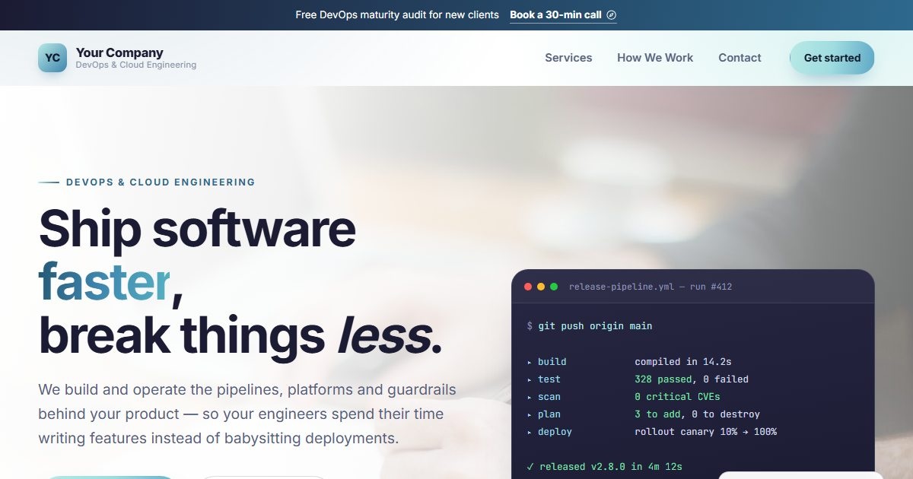
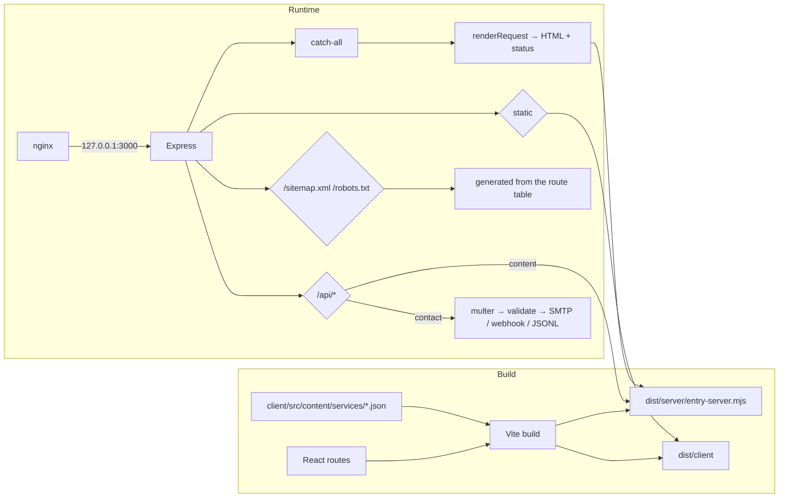

# DevOps Site

**A server-rendered marketing site for a cloud-engineering practice — 44 routes, 40 service pages generated from JSON content, an Express contact API, and a build-once/ship-the-artifact CI/CD pipeline.**

[](https://react.dev)
[](https://vite.dev)
[](https://expressjs.com)
[](https://nodejs.org)
[](.github/workflows/deploy.yml)
[](LICENSE)

[Live site](https://devops.theaimax.com) · [Architecture](#architecture) · [Quick start](#quick-start)



---

## What it is

A production marketing site for a DevOps / cloud-engineering business. It is not a static page — it renders React on the server, hydrates on the client, and exposes a real API for the contact form.

The interesting constraint was **content scale without code churn**: 40 service pages that each need unique copy, metadata, anchors and SEO. Adding a service is a JSON file, not a component. The server and the client share one route table, so the server can never disagree with the browser about which URLs exist or which status code a URL should return.

### What is actually built

- **44 renderable routes** — home, services index, 40 service detail pages, about, contact, plus a catch-all that returns a real `404` status.
- **SSR + hydration** — the same `entry-server` / `entry-client` bundle pair, no framework, no Next.js.
- **JSON content model** — one file per service under `client/src/content/services/`, validated at build time.
- **Contact API** — multipart form, honeypot spam trap, IP rate limiting, SMTP delivery via Nodemailer, optional webhook, and a JSONL fallback store so a submission is never silently lost.
- **SEO done properly** — canonical URLs, Open Graph and Twitter tags, JSON-LD structured data, a sitemap generated from the live route table, and legacy `.html` URLs 301-redirected to their new paths.
- **No-JS resilience** — because the page is server-rendered, the content is readable before any JavaScript executes.
- **CI/CD with a real gate** — four content/render check suites must pass before anything is deployed, and the deploy ends with an HTTP smoke test against the public URL.

---

## Architecture



Three things are worth calling out because they are easy to get wrong:

1. **`trust proxy` is scoped to `loopback`, not `true`.** With `true`, Express believes the `X-Forwarded-For` header from anyone, and a client can forge their address straight past the rate limiter. The reverse proxy runs on the same host, so only loopback needs to be trusted.
2. **HTML is served `no-cache`; hashed assets are `immutable`.** Cached HTML would point at asset hashes that no longer exist after a deploy. The stylesheet and images keep their original filenames, so they revalidate hourly instead.
3. **The sitemap is generated from the route table**, not hand-maintained — it cannot drift from the pages that actually exist.

---

## Quick start

```bash
git clone https://github.com/aiplusplus360/devops-site.git
cd devops-site
npm ci
npm run dev          # http://localhost:3000
```

For a production-shaped run:

```bash
npm run build        # builds the client bundle and the SSR bundle
npm start            # Express on :3000, serving dist/client + SSR
```

No environment variables are required to browse the site. The contact form falls back to writing submissions to disk when SMTP is not configured.

---

## Configuration

Copy `.env.example` to `.env` and fill in what you need. Everything is optional except `PORT` in production.

| Variable | Default | Purpose |
| --- | --- | --- |
| `PORT` | `3000` | Port Express listens on |
| `HOST` | `0.0.0.0` | Bind address — set `127.0.0.1` in production so the app is only reachable through nginx |
| `SMTP_HOST` | — | SMTP server hostname; omit to disable email delivery |
| `SMTP_PORT` | `587` | SMTP port |
| `SMTP_SECURE` | `false` | `true` for implicit TLS (port 465) |
| `SMTP_USER` | — | SMTP username |
| `SMTP_PASS` | — | SMTP password or app password |
| `CONTACT_FROM` | — | `From:` address on notification emails |
| `CONTACT_TO` | — | Inbox that receives submissions |
| `CONTACT_WEBHOOK_URL` | — | Optional JSON webhook fired on each submission (Slack, Discord, n8n…) |
| `SUBMISSIONS_DIR` | `server/data` | Where the JSONL fallback store lives — keep it outside the deploy target |
| `LOG_RENDERS` | — | Set to log `status url "title"` for every render |

---

## Scripts

| Command | What it does |
| --- | --- |
| `npm run dev` | Dev server with HMR |
| `npm run build` | Vite client build + SSR build |
| `npm start` | Production Express server |
| `npm run check` | Runs all four content/render suites |
| `npm run content:check` | Every service id has copy, and every copy file is referenced |
| `npm run check:content` | Content model coherence — icons, categories, unique ids |
| `npm run check:render` | All 40 services render; section slugs are unique; HTML hooks exist |
| `npm run check:routes` | All 44 routes render with unique metadata and no legacy links |
| `npm run check:email` | Verifies SMTP credentials with a real handshake |

The check scripts are deliberately plain Node — no test framework — so they run in ~1s and can sit in front of every deploy.

---

## Adding a service

Drop a JSON file into `client/src/content/services/` and register the id:

```json
{
  "id": "observability",
  "name": "Monitoring & Observability",
  "category": "Reliability",
  "summary": "One-line pitch shown in bold under the title.",
  "bullets": ["First proof point", "Second", "Third"],
  "featured": true
}
```

The route `/services/observability` exists immediately, appears in the sitemap, and is picked up by the contact form's `?service=` prefill. Run `npm run check` and the guard rails will tell you if anything is missing.

---

## Deployment

`main` is protected by a two-job pipeline ([`.github/workflows/deploy.yml`](.github/workflows/deploy.yml)):

1. **verify** — `npm ci`, build, then all four content and route suites. A missing service page fails the pipeline here, so broken content never reaches production.
2. **deploy** — rsync the built artifact to the VPS, install/update the systemd unit and nginx site, reload nginx *only after* `nginx -t` passes, restart the service, then smoke-test the live URL (`/`, `/services`, `/services/cicd`, and a 404 assertion).

The shape is **build once, ship the artifact**: nothing is compiled on the VPS, and the exact artifact that passed the checks is the one that goes live. The SSH host key is pinned in a secret rather than scanned at deploy time, so a MITM cannot silently capture the deploy key.

Required repository secrets: `VPS_SSH_KEY`, `VPS_HOST`, `VPS_USER`, `VPS_HOST_KEY`.

Server-side templates live in [`deploy/vps/`](deploy/vps/), and generic nginx / Apache examples in [`deploy/`](deploy/).

---

## Project structure

```
devops-site
├── client
│   ├── index.html                 Vite entry template
│   └── src
│       ├── routes.jsx             One route table, shared by client and server
│       ├── routes/                Home, Services, ServiceDetail, About, Contact, NotFound
│       ├── components/            Header, Footer, Faq, Plans, Process, Icon, …
│       └── content/services/*.json   40 service pages, one file each
├── server
│   ├── index.mjs                  Express: API → sitemap → static → SSR → errors
│   ├── api/contact.mjs            multipart, honeypot, rate limit, SMTP, webhook, JSONL
│   ├── api/content.mjs            JSON content API
│   └── lib/                       render, meta/head tags, mailer
├── deploy
│   ├── vps/                       systemd unit + nginx site for the VPS
│   ├── check-*.js                 content, render and route check suites
│   └── nginx.conf.example         Generic nginx config
├── assets/                        Images and stylesheet, copied into the build
└── .github/workflows/deploy.yml   Verify → deploy → smoke test
```

---

## Notes

- **Images are stock photography** and credited in [`assets/img/CREDITS.md`](assets/img/CREDITS.md). Testimonials deliberately use initials rather than photos of real people — no model releases required.
- **The tech logos are hand-authored simplified marks**, not official vendor assets. Swap in the real ones from each vendor's brand page before commercial use.
- **No CSP is set in Express on purpose.** The correct policy depends on the fonts, analytics and embeds you add, and a wrong one silently breaks the page. See `deploy/nginx.conf.example` for where to put one.

## License

[MIT](LICENSE)
